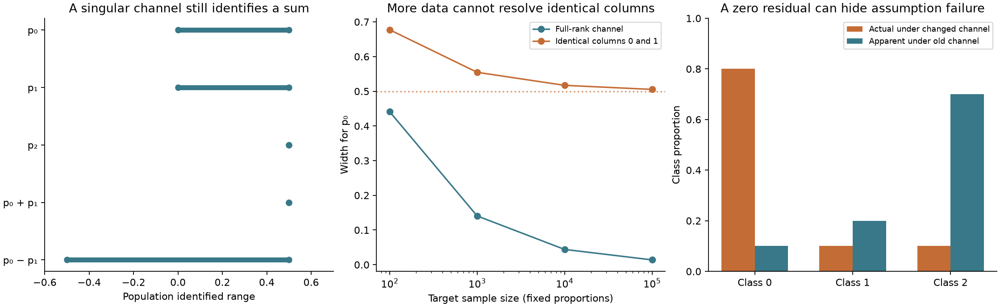

# Label-shift identified sets

What can unlabeled target predictions tell us about target class proportions?
This project computes **ranges of compatible priors**, including when two classes
have indistinguishable prediction distributions. It separates structural
non-identifiability, target sampling uncertainty, and failures of the assumed
prediction channel.

The implementation contains a linear-programming solver, attaining endpoint
priors, a small independent exact-rational vertex oracle, fixed-sample confidence
bands, and a reproducible synthetic study. There is no classifier training or
real-world performance claim.

## Run

Python 3.11 or newer. From the repository root:

```bash
python3 -m venv .venv
source .venv/bin/activate
python -m pip install -r requirements-repro.txt
python -m pip install --no-deps .
python -m pytest -q
python -m shift_sets.demo --output results
shift-bounds results/example.json
```

The pinned dependency file reproduces the Python 3.13 development environment,
with compatible NumPy, SciPy and ContourPy pins selected by environment markers
on Python 3.11. Compatible
dependency ranges are also declared in `pyproject.toml`; to use those instead,
run `python -m pip install '.[test]'`. The demo uses Matplotlib, included in the
test extra. The core package only needs NumPy and SciPy. No network access is
needed after installation. Both Python 3.11 and 3.13 are checked in CI.

## Model and estimand

Let `Y` be the unobserved target class, `Z` a fixed categorical predictor output
or prespecified score bin, and `p[j] = P_target(Y=j)`. The supplied matrix is

```text
A[i,j] = P(Z=i | Y=j),       q = A p.
```

Rows are output bins and **columns are true classes**. Columns must sum to one.
This is a conditional channel, not the joint confusion matrix `P(Z,Y)` used by
some formulations. No source-class prior is needed when this channel is known.

The key assumption is that this conditional channel is known and unchanged in
the target population. Full label shift, `P_target(X|Y)=P_source(X|Y)` with a
fixed predictor, implies the required invariance. Invariance of the coarsened
channel alone is weaker. Unlabeled predictions cannot generally verify either
assumption.

For supplied bin-probability bounds `lower`, `upper`, the feasible prior set is

```text
P = {p : p >= 0, sum(p) = 1, lower <= A p <= upper}.
```

For each class and requested weight vector `c`, two LPs minimize and maximize
`c @ p` over the **same** set. Every returned endpoint includes an attaining
prior. These are sharp bounds relative to this model and these input bands,
subject to numerical solver tolerances. The coordinate intervals form an outer
rectangle: arbitrary combinations of their endpoints need not be feasible.
Request a contrast directly rather than adding separate coordinate bounds.

A population calculation uses `lower=upper=q`. Full column rank identifies a
unique compatible prior, but rank deficiency need not destroy every contrast.
The simplex boundary can also identify an individual prior even when the matrix
is rank deficient; rank alone does not describe the local feasible set.

## Sampling uncertainty

In counts mode the target observations must be iid draws of one categorical
output at a **fixed, prespecified sample size**. For `B` bins, each marginal
count has distribution `Binomial(n,q[i])`. The code forms a two-sided
Clopper–Pearson interval with error probability `alpha/B` for each bin:

```text
lower[i] = BetaQuantile(alpha/(2B); count[i], n-count[i]+1)
upper[i] = BetaInverseSurvival(alpha/(2B); count[i]+1, n-count[i])
```

At zero successes the lower endpoint is zero; at `n` successes the upper
endpoint is one. By the union bound, all bin intervals jointly cover `q` with
probability at least `1-alpha`. The multinomial counts need not be independent.
Under the known invariant channel assumption, on that event the true `p` lies
in the feasible set, so **all linear contrasts** are covered simultaneously.
The guarantee is finite sample and conservative; beta quantiles and LP solutions
are evaluated numerically.

This guarantee **does not cover uncertainty in an estimated source channel**,
adaptive binning, a predictor fitted using the same target sample, dependent
target observations, or optional stopping. Plugging in an estimated confusion
matrix does not inherit the stated guarantee. The demo deliberately uses known
synthetic channels.

## Infeasibility and numerical diagnostics

An incompatible set returns `status="infeasible"` and no prior ranges. A second
LP reports the smallest common additive expansion `delta >= 0` making

```text
lower - delta <= A p <= upper + delta
```

feasible. It includes an attaining simplex prior. This is a distance in bin
probability units, **not a p-value**, posterior probability, or automatic repair
to use for confidence claims. Incompatibility may reflect sampling, an incorrect
channel, or invalid input assumptions. Compatibility does not certify label shift.

SciPy HiGHS solves the LPs with primal/dual feasibility tolerances `1e-9`.
Every returned primal witness is checked against the original constraints with
tolerance `2e-8`; solver failures or failed checks raise an error. Contrast
objectives are scaled before optimization. No exact dual certificate is claimed.
Near feasibility boundaries or with nearly indistinguishable columns, floating
point classifications and narrow ranges require care. Singular values and a
numerical rank are reported; condition number is null without full column rank.
Inputs are never silently normalized or clipped.

The reference implementation enumerates active constraints and solves their
linear equations with `fractions.Fraction`. It uses no production solver and is
limited to 100,000 combinations. This independent small-problem check is not the
scalable computation path.

## Synthetic experiments

All matrices, priors, and count vectors are specified in `demo.py`. No external,
private, personal, or application data are used. There is no random generator in
the demo; the sample-size experiment fixes observed proportions, and the
coverage experiment enumerates every possible count vector.



**Partial identification.** For

```text
A = [[0.8, 0.8, 0.1],
     [0.1, 0.1, 0.2],
     [0.1, 0.1, 0.7]],       q = [0.45, 0.15, 0.40],
```

the first two classes have identical columns. The exact feasible segment joins
`(0, 1/2, 1/2)` and `(1/2, 0, 1/2)`. Thus each of `p[0]` and `p[1]` ranges from
0 to 0.5, while `p[0]+p[1]=0.5` and `p[2]=0.5`. More target data cannot resolve
the split. Directly adding the marginal bounds would incorrectly suggest a
range `[0,1]` for the sum; the contrast LP returns `[0.5,0.5]`.

**Sample size.** A second channel,

```text
A_full = [[0.7, 0.2, 0.1],
          [0.2, 0.6, 0.2],
          [0.1, 0.2, 0.7]],
```

has full column rank. Both channels use prior `[0.2,0.3,0.5]`. Fixed target
proportions at sample sizes 100, 1,000, 10,000 and 100,000 illustrate shrinking
uncertainty for the full-rank channel and persistent ambiguity for the singular
one. These are a controlled width comparison, not random coverage replicates.

| Target size | Width for `p[0]`, full rank | Width for `p[0]`, identical columns |
| ---: | ---: | ---: |
| 100 | 0.440987 | 0.677251 |
| 1,000 | 0.140575 | 0.554726 |
| 10,000 | 0.044062 | 0.517113 |
| 100,000 | 0.013890 | 0.505390 |

**Detectable incompatibility.** Under `A_full`, no prior can produce a first-bin
probability above 0.7. Population vector `[0.95,0.03,0.02]` is incompatible and
requires a common band expansion of 0.25. This population example has no
sampling noise.

**Invisible conditional shift.** Let the actual target prior be `[0.8,0.1,0.1]`
and let every column of a changed target channel equal
`A_full @ [0.1,0.2,0.7] = [0.18,0.28,0.54]`. Its unlabeled output distribution
looks exactly like prior `[0.1,0.2,0.7]` under the old channel. The old-channel
audit is feasible with zero relaxation, while its apparent prior has L1 error
1.4 relative to the actual prior. Even infinitely many unlabeled outputs cannot
distinguish these two explanations.

**Exhaustive coverage.** For `A_full`, prior `[0.2,0.3,0.5]`, `n=20` and
`alpha=0.05`, the demo enumerates all 231 three-bin count vectors. Multinomial
probability masses are rational and sum exactly to one. The output reports
coverage of the full feasible set, coverage of its coordinate rectangle, and
the probability of an empty set. Interval membership still uses floating-point
beta quantiles; this is an enumeration benchmark, not an exact-arithmetic
confidence-interval implementation. See `results/summary.json` for full values.

| Enumerated quantity | Probability |
| --- | ---: |
| Full feasible set covers the true prior | 0.9764228896 |
| Coordinate rectangle covers the true prior | 0.9836461772 |
| Feasible set is empty | 0.0000013993 |

The rectangle can contain a prior that violates a joint constraint, explaining
its higher coverage. These values describe this specific synthetic setting;
they are not an empirical claim about deployed classifiers.

## API and CLI

```python
from shift_sets import audit, multinomial_bands

A = [[.8, .8, .1], [.1, .1, .2], [.1, .1, .7]]
band = multinomial_bands([450, 150, 400], alpha=.05)
report = audit(A, band["lower"], band["upper"], contrasts=[[1, 1, 0]])
print(report["ranges"][-1])  # sum of priors 0 and 1, with endpoint witnesses
```

`shift-bounds input.json` accepts exactly one of these forms:

```json
{"channel": [[0.8, 0.2], [0.2, 0.8]], "counts": [6, 4], "alpha": 0.05}
```

```json
{"channel": [[0.8, 0.2], [0.2, 0.8]], "lower": [0.48, 0.48], "upper": [0.52, 0.52], "contrasts": [[1, -1]]}
```

Explicit bands carry no automatic coverage claim. `alpha` is only valid with
counts; default 0.05. The input file is read without modification; JSON goes to
stdout. Duplicate or unknown fields are rejected. Exit codes: 0 feasible,
1 invalid input, 2 infeasible, 3 numerical failure. Matrices have at most 100
rows/columns, at most 100 additional contrasts; count totals are 1 to `10^9`
and `alpha` is in `[1e-10,1)`. These are implementation limits, not statistical
assumptions. Dense LPs solve two objectives per requested functional.

## Validation and scope

Tests check known feasible segments, uninformative and full-rank channels,
attaining witnesses, 12 independently constructed rational polytope references,
infeasibility distances, contrast scaling, band inclusion, permutation
invariance, boundary counts, binomial-root confidence interval references,
exhaustive multinomial coverage, invalid inputs, and CLI exit behavior.
The local validation run passes 65 tests, runs the complete demo and installed
CLI, and reproduces both JSON artifacts byte for byte on a second demo run.

This is a small research software example, not a complete domain adaptation
system. It does not estimate a source channel, correct individual predictions,
choose bins, infer causal effects, or prove that real data satisfy label shift.
A useful next extension would explicitly propagate source-channel estimation
uncertainty; it is not implemented here.

## References

- Lipton, Wang and Smola (2018), [Detecting and Correcting for Label Shift with
  Black Box Predictors](https://proceedings.mlr.press/v80/lipton18a.html), provides
  the black-box label-shift setting. This repository explores feasible-set
  geometry rather than reproducing their estimation algorithm.
- SciPy's [exact binomial interval documentation](https://docs.scipy.org/doc/scipy-1.16.1/reference/generated/scipy.stats._result_classes.BinomTestResult.proportion_ci.html)
  identifies the Clopper–Pearson method and its original 1934 reference.
- [SciPy binomial implementation](https://github.com/scipy/scipy/blob/main/scipy/stats/_binomtest.py)
  provides the binomial-tail inversion reference used to check the beta-quantile
  computation in tests.

The LP construction, examples, tests, rational oracle, and code here were written
for this repository. MIT licensed.
